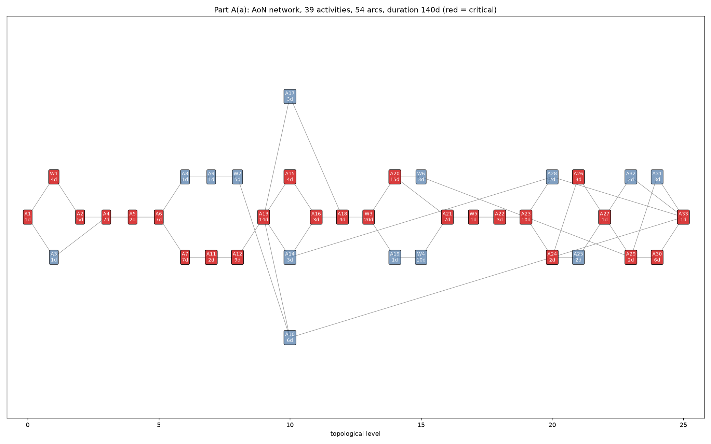
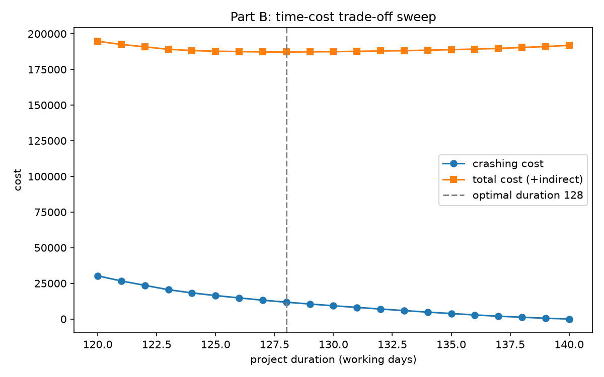
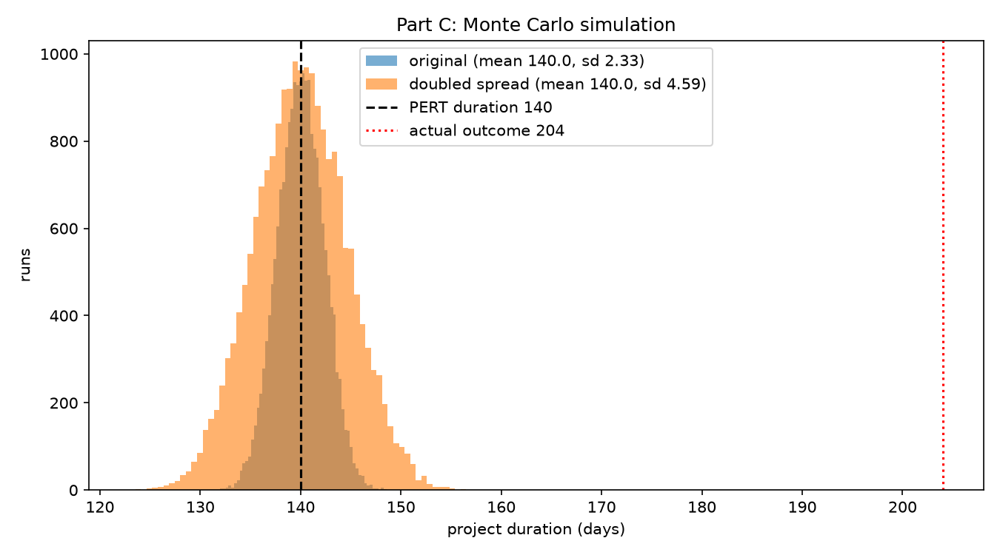
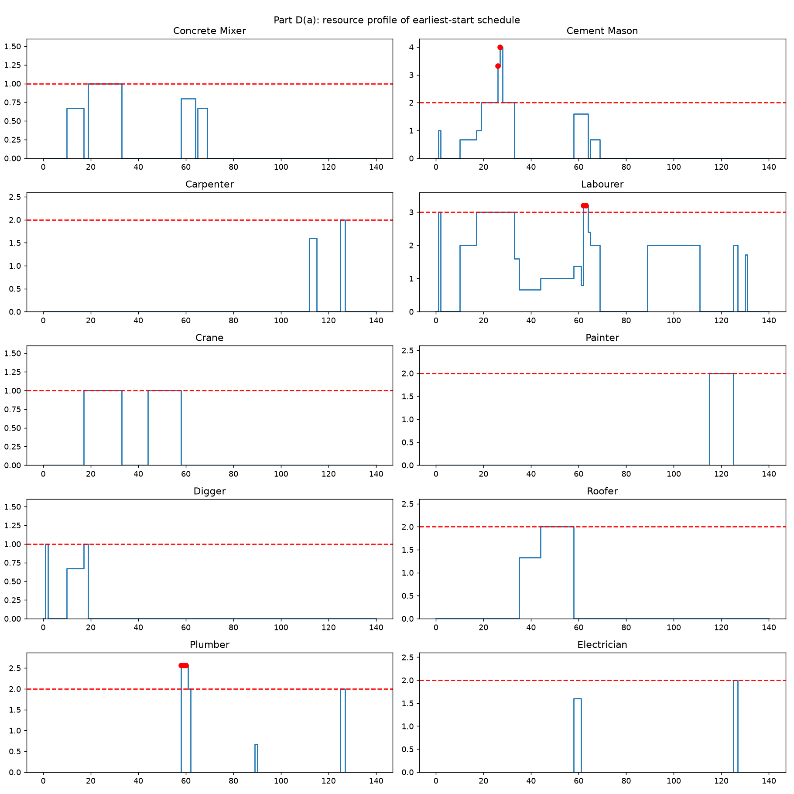

# IE 441 — Assignment 2: Scheduling a Real Project
## Group 17 — *Building a Dream* (C2012-17, residential construction, 39 activities, 10 renewable resources)

**Headline numbers**

| Quantity | Value |
|---|---|
| Network (activities / precedence arcs / order strength) | 39 (33 real + 6 waits) / 54 / **0.825** |
| Part A — critical-path length | **140 working days** |
| Part B — crashable range / cheapest-optimal duration | 120–140 / **128 days** (crashing + indirect **187,189.71**; incl. direct **428,204.71**) |
| Part C — PERT duration / CP σ / simulated mean (sd) | 140 / 2.04 / **140.03 (2.33)** |
| Part D — best heuristic makespan (scheme, rule) | **140 (serial SGS, any rule)** |
| Part E — exact RCPSP optimum (HiGHS, proven optimal) | **140** — resources do *not* delay this project |
| Planner's baseline | 144 days |
| What actually happened | 204 days (≈ 27σ beyond the modelled distribution) |

All computation is in the single script `solution/solve_all.py` (Parts A–E and the Part E side-experiments,
Pyomo + HiGHS); machine-readable outputs in `solution/outputs/`. Run with
`python solution/solve_all.py` (options: `--data-dir`, `--out-dir`; prints Python/Pyomo/NumPy/HiGHS versions
at startup — this run: Python 3.12.9, Pyomo 6.10.1, HiGHS 1.15.1).
Every section below was cross-checked by assertions inside the script (CP-duration sum, sweep monotonicity,
feasibility of crashed schedules, MILP bound ≤ optimum, LP bounds ≤ MILP optimum, PERT duration = CPM duration).

---

## Part A — The project and its critical path (15%)

### A(a) Network

The activity-on-node network has **39 activities** (33 work activities `A1–A33` and 6 inserted wait
activities `W1–W6` that model the planner's positive lags) and **54 finish-to-start precedence relations**
(48 original links; 3 links that were not finish-to-start were simplified to FS with zero lag, and
8 positive lags were modelled as the 6 explicit wait activities — `link_provenance` in `proj_17_brief.json`).
Every dependency is FS with zero lag; waits are ordinary activities with no resources, no cost and no crashing.

With *n* = 39 there are n(n−1)/2 = 741 activity pairs; reachability analysis of the precedence graph finds
**611 ordered pairs**, so the **order strength is 611/741 = 0.8246**. This is very high (PSLIB instances
typically sit near 0.2–0.4): the network is essentially one long chain with small side branches, which
shapes everything that follows (tiny merge bias in Part C, near-zero resource delay in Parts D/E).

### A(b) Forward and backward pass

Project duration **T = 140 working days** (every duration in `proj_17.csv` equals `duration_normal` in
`proj_17_tct.csv`; verified by assertion).

**Critical path (25 activities):**
`A1 → W1 → A2 → A4 → A5 → A6 → A7 → A11 → A12 → A13 → A15 → A16 → A18 → W3 → A20 → A21 → W5 → A22 → A23 → A24 → A26 → A27 → A29 → A30 → A33`

Four slack measures per activity (definitions: TF = LS−ES; FF = min ES of successors − EF;
SF = LS − max LF of predecessors; IF = min ES of successors − max LF of predecessors − duration, floored at 0).
The full 39-row table is **Appendix A**; interesting rows:

| Activity | Name | dur | ES | TF | FF | SF | IF | Comment |
|---|---|---|---|---|---|---|---|---|
| A1 | Soil Research | 1 | 0 | 0 | 0 | 0 | 0 | critical, project start |
| A3 | Building site preparation | 1 | 1 | 8 | 8 | 8 | 8 | fully parallel with W1 branch |
| A8 | Test jointing | 1 | 26 | 100 | 0 | 100 | 0 | TF=100 but FF=0: pushes A9 only |
| A9 | Choosing joint type | 1 | 27 | 100 | 0 | 0 | 0 | predecessor-dominated |
| A10 | Jointing | 6 | 58 | 75 | 75 | 0 | 0 | huge float, none of it its own |
| A14 | Electricity | 3 | 58 | 1 | 1 | 1 | 1 | near-critical twin of A15 |
| A15 | Sanitary | 4 | 58 | 0 | 0 | 0 | 0 | on the critical path |
| A17 | Underfloor heating | 3 | 58 | 4 | 4 | 4 | 4 | parallel with A15/A16 |
| A25 | Installation of kitchen | 2 | 127 | 1 | 1 | 1 | 1 | near-critical twin of A26 |
| A26 | Installation of bathroom | 3 | 127 | 0 | 0 | 0 | 0 | critical |
| A30 | Garden landscaping | 6 | 133 | 0 | 0 | 0 | 0 | critical |
| A31 | Terrace construction | 3 | 133 | 3 | 3 | 3 | 3 | parallel with A30 |
| W2 | wait 5d after A9 | 5 | 28 | 100 | 25 | 0 | 0 | the A8–A9–W2 branch feeds A10 |
| W6 | wait 3d after A20 | 3 | 104 | 8 | 8 | 8 | 8 | A23 is pulled later by W5/A22 |

### A(c) Why our 140 days ≠ `planner_baseline_duration_days` = 144

**The four days are located, activity by activity, in the planner's own dates.** Comparing each critical
activity's recorded start with its CPM earliest start (same weekday calendar, Mon 2013-03-04 = day 0):
the chain begins exactly on schedule — A1 through A5 start on days 0, 5, 10, 17 — and then drifts one
working day later at **A6 (+1), A18 (+1), A22 (+1) and A23 (+1)**, holding the accumulated **+4** all the
way to A33 (planned start day 143 vs ES 139). Column `idle_vs_CPM` in
`solution/outputs/partA_baseline_compare.csv` shows this build-up explicitly. So the planner's baseline
genuinely consumes four one-day buffers on the critical chain, and the brief's **144 is simply the working
days from his first start to his last recorded finish, counting the start day but not the finish day**
(Mon 2013-03-04 → Fri 2013-09-20) — no holiday arithmetic required.

What the four single-day drifts are:

- **Three of them follow a predecessor whose recorded dates span more working days than its duration.**
  A6 follows **A5** — recorded 27–29 March, *3 weekdays for a 2-day task*; A18 follows **A16** — recorded
  30 May–5 June, *5 weekdays for 3 days*; A22 follows **A21** — recorded 30 July–9 August, *9 weekdays for
  7 days* — and each successor starts on or right after the recorded end (A18 starts on the very day A16's
  recorded end falls; A22 comes after A21's end plus the one-day W5 wait), handing the extra day down the
  chain. The pattern is consistent with durations recorded in hours and rounded to whole days (the
  assignment's own conversion convention). We present it as the likely explanation — the dates alone cannot
  prove it.
- **The fourth step is Assumption Day, at A23.** A22 occupies Mon–Wed 12–14 August, so A23 could start on
  Thursday 15 August; 15 August is a public holiday, and A23 starts on Friday the 16th. (A22's recorded end
  of 15 August is the end-date convention: its last worked day is the 14th.) The same reading shows
  **Easter Monday was worked** (A6 fits its 7 days only if 1 April counts) and **May Day was worked**
  (A12 fits its 9 days only with 1 May counted) — the planner's calendar did not observe Belgian holidays
  consistently.
- The dates elsewhere are dominated by a recording convention — 18/33 activities are consistent with
  "end date = first day after the last worked day", and 16 activities start exactly one weekday before
  their predecessors' recorded end dates — which is why the drifts appear as single clean weekdays rather
  than multi-day gaps.

**Off the critical chain** the planner's dates contain another **21 idle working days** — A10 *Jointing*
(+11: it starts 2013-06-11, eleven working days after predecessor A13 finished 2013-05-24, plausibly
waiting for windows/glazing deliveries), A8 *Test jointing* (+7) and A17 *Underfloor heating* (+3).
Crucially this idle time does **not** extend the project: all of it sits on activities with 75–100 days of
total float, so it explains why some of his crews stood still, not why his number is 144.

**Conclusion:** our 140 is the network minimum; the planner's 144 is his own start-to-end span and contains
four one-day chain drifts — three inherited from predecessors whose recorded date-spans exceed their
durations (most plausibly the hours-to-days rounding), one the Assumption Day holiday — plus a separate
21 float-absorbed idle days off the chain, which say how the site was run but nothing about the duration.

### A(d) Which slack measure to quote, per named activity

- **A1 Soil Research** — quote **total float (0)**: it is the project's first activity and genuinely critical;
  any slip moves the whole project.
- **A3 Building site preparation** — quote **total float (8)**: it runs in parallel with the A1→W1→A2 branch and
  has 8 days of float that is entirely *its own* (FF = SF = IF = 8); the foreman may use all of it without any
  downstream effect.
- **A10 Jointing** — quote **safety float (0), not total float (75)**: its 75 days of float all comes from its
  predecessors finishing early; if the chain feeding it (A13's roof chain, or A8→A9→W2) is late, A10 itself has
  *no* cushion (SF = IF = 0). Total float would give its subcontractor a dangerously false sense of slack.

---

## Part B — Crashing (20%)

Crashing is linear per `proj_17_tct.csv`; waits cannot be crashed. Fully crashed the project lasts **120 days**
(CPM on `duration_crash`), uncrashed 140.

### B(a) Time–cost trade-off LP (Pyomo, HiGHS)

Variables: `y_i ∈ [0, max_red_i]` (crash days), start times `S_i ≥ 0`; durations `d_i = D_i − y_i`.
Minimise `Σ rate_i · y_i` s.t. `S_j ≥ S_i + d_i` for all 54 arcs and `S_A33 + d_A33 ≤ δ`.
Solved for deadline **δ = 130** (strictly between 120 and 140):

| Activity | Name | Crashed | Rate (per day) | Cost |
|---|---|---|---|---|
| A30 | Garden landscaping | 1 d | 522.75 | 522.75 |
| A4 | Building foundation | 2 d | 719.32 | 1,438.64 |
| A5 | Sewerage & drainage | 1 d | 892.00 | 892.00 |
| A26 | Installation of bathroom | 1 d | 974.07 | 974.07 |
| A22 | Carpenting | 1 d | 1,001.45 | 1,001.45 |
| A16 | Placing windows | 1 d | 1,045.45 | 1,045.45 |
| A13 | Roof covering | 3 d | 1,132.39 | 3,397.17 |
| **Total** | | **10 d** | | **9,271.53** |

All crashed activities are on the (evolving) critical path — the LP never pays for non-critical days.

### B(b) Deadline sweep

Solving the LP for every integer deadline 140 → 120 gives a convex, piecewise-linear crashing cost
(0 at 140 rising to 30,265.53 at 120). Plot:

### B(c) Critical activities along the sweep

The critical set is the TF = 0 set of the CPM pass on each deadline's optimal crashed durations
(full table: `solution/outputs/partB_sweep.csv`). It changes **twice**:

- **δ = 135:** A25 *Installation of kitchen* joins (25 → 26 activities), after A26 is crashed its maximum
  one day and ties with its twin.
- **δ = 123:** A14 *Electricity* joins (26 → 27), after A15 is crashed its maximum one day and ties with
  its twin.

**Neither change moves the marginal cost.** Because the network is close to a single chain, the LP simply
crashes critical activities in rate order — 522.75 → 719.32 → 892.00 → … → 3,592.67 — and the newly
critical twins A25 and A14 never need to be shortened while cheaper shared activities remain. A26 and A15
each have a maximum reduction of one day, so once crashed, the tied twin segment cannot be shortened
further at any price; the LP simply continues on the shared chain activities in rate order. This contrasts
with the lecture example, where a second binding path **doubled** the marginal cost of a day from 100 to
200: our network has no second path that becomes binding and forces the LP onto a more expensive segment,
so the marginal cost climbs smoothly instead of jumping.

The crashed activities themselves enter **strictly in ascending rate order** — A30 (139), A4 (138–137),
A5 (136), A26 (135), then simply the next cheapest, A22 (134), A16 (133), A13 (132–130), A12 (129–128),
A18 (127), A24 (126), A2 (125), A6 (124), A15 (123), A21 (122–121), A29 (120) — each multi-day activity
reappearing at the next deadline until its `max_reduction` is exhausted.

### B(d) Optimal total cost with indirect cost 1,370.43/day

Total(δ) = **crashing + indirect** = crash cost(δ) + 1,370.43·δ over the sweep. **Minimum at δ* = 128 days:
total 187,189.71** (crashing 11,774.67 + indirect 175,415.04; crashed: A30 1d, A4 2d, A5 1d, A26 1d, A22 1d,
A16 1d, A13 3d, A12 2d). The optimum sits where the next marginal crash (1,415.32 for A18) exceeds the daily
indirect saving of 1,370.43. Adding the constant normal direct cost (241,015.00 = Σ baseline_cost) shifts
every total up by exactly that amount — full direct + crashing + indirect optimum **428,204.71** — and
changes no decision, which is why the sweep column carries crashing + indirect only
(`total_cost_incl_direct` in `partB_sweep.csv` for the full figure).

**Flatness:** the optimum is *flat*. Total(125) = 187,736.71 (**+547.00** for −3 days) and
Total(131) = 187,665.47 (**+475.76** for +3 days) — a 3-day shift costs ≈ 0.25–0.3 % of the total.
If the optimum moved three days for any reason (an indirect-cost estimate off by ±3 %, say), the cost
consequence is a few hundred units — the schedule is far more sensitive at its extremes (120 costs
+7,527.42) than anywhere near 128.

---

## Part C — Risk (15%)

### C(a) PERT means and variances

All triples are symmetric ((a+b)/2 = m), so PERT mean = m = `proj_17.csv` duration for every activity and
the **PERT project duration is again 140 days** (asserted). Critical-path variance = Σ((b−a)/6)² over the
25 critical activities = **4.1644 → σ = 2.04 days**. Waits contribute zero variance (deterministic triples).

### C(b) Simulation (20,000 runs, Beta-PERT sampling from each triple, seed 42)

| Scenario | Mean | SD | p10 | p50 | p90 | max | P(T ≤ 140) | mean − PERT |
|---|---|---|---|---|---|---|---|---|
| Original triples | 140.03 | 2.33 | 137.03 | 140.04 | 143.03 | 148.6 | **0.4927** | **+0.03** |
| Doubled spread, same means | 140.01 | 4.59 | 134.07 | 140.00 | 145.94 | 156.5 | **0.5001** | **+0.01** |

Doubled spread: a′ = μ − 2(μ−a), b′ = μ + 2(b−μ) (waits stay deterministic); Beta-PERT shapes are unchanged,
the support stretches.

**Both gaps are essentially zero and stay zero — because the competing paths are almost entirely the same
path.** This network is *not* a single chain: it has **1,100 maximal paths**, and six of them lie within one
standard deviation of the critical path (lengths **140, 139, 139, 138, 138, 138**). The gap stays near zero
anyway, and the reason is **path correlation, not path scarcity**:

- Each challenger shares **23–24 of its 25 activities** with the critical path. The two 139-day paths differ
  from the CP on a *single activity* — A14 *Electricity* (3 days) in place of A15 *Sanitary* (4 days), or
  A25 *Installation of kitchen* (2) in place of A26 *Installation of bathroom* (3); the 138-day paths differ
  on two such segments.
- Each competing segment is deterministically 1 day shorter than the CP segment, and its length difference
  has σ ≈ **0.33 days** (A14: (b−a)/6 = 0.2, A15: 0.267 → σ_diff = √(0.2² + 0.267²) = 0.333). So for the
  challenger to *tie* the CP it must overrun its mean by 1 day ≈ **3σ** in the base scenario — P ≈ 0.13 %,
  matching the measured criticality index for A14 (CI = 0.0012). With the doubled spread that threshold
  falls to ≈ 1.5σ, P ≈ 7 % by the same approximation — the measured CI (A14: 0.0985) is a little higher
  because the beta sampling has heavier tails than a normal, but the mechanism is the same.
- A winning challenger can overshoot 140 — but only by the small amount it overruns *beyond* the 1-day
  deficit. A normal approximation for one twin segment (slack 1 day, σ_diff = 0.333) puts the expected
  excess per segment at ≈ **0.0001 days** in the base case and ≈ **0.02 days** with the doubled spread —
  ≈ **+0.04 days in total** for the doubled case. That is the whole merge-bias term here, and it is smaller
  than the Monte Carlo noise: with 20,000 runs the standard error of the simulated mean is ≈ 0.016 (base)
  and ≈ 0.032 (doubled), so the simulated gaps (+0.03, +0.01) are consistent with the theory rather than
  "exactly zero". Merge bias — the extra expected length from taking a max over several long paths — needs
  paths that are long *and different*; here they are long *because they are almost identical*, so the max
  adds almost nothing.

Widening the spread therefore shows up almost entirely in the dispersion — σ 2.33 → 4.59, p90 143.0 → 145.9,
max 148.6 → 156.5 — while the mean gap stays within Monte-Carlo noise of its theoretical value (a few
hundredths of a day). The explanation
lives in the overlap structure of the paths, exactly as the assignment hints: a zero gap has a network
explanation, and this is it.

### C(c) Criticality indices

CI = fraction of runs in which the activity has zero total float (continuous sampling ⇒ unique realised
critical path). Full table: `solution/outputs/partC_criticality.csv`; beside Part A total float:

| Activity | TF (A) | CI base | CI doubled |
|---|---|---|---|
| A1, A2, A4, A5, A6, A7, A11, A12, A13, A16, A18, A21, A22, A23, A24, A27, A29, A33, W1, W3, W5 | 0 | 1.000 | 1.000 |
| A15 Sanitary | 0 | 0.9988 | 0.9015 |
| A20 Plastering | 0 | 1.000 | 0.9657 |
| A26 Installation of bathroom | 0 | 1.000 | 0.9667 |
| A30 Garden landscaping | 0 | 1.000 | 0.9998 |
| A14 Electricity | 1 | 0.0012 | **0.0985** |
| A19 / W4 | 4 | 0.000 | 0.034 |
| A25 Installation of kitchen | 1 | 0.000 | 0.033 |
| A31 Terrace construction | 3 | 0.000 | 0.0003 |
| all others (positive slack) | ≥ 4 | 0.000 | 0.000 |

- **Part-A-critical activities with CI < 0.9: none** (the lowest is A15 at 0.9988 base; with doubled spread
  A20 and A26 dip to 0.966/0.967 but stay above 0.9). The chain activities are critical almost deterministically.
- **Positive-slack activities with CI > 0.05: none in the base scenario** (A14, with TF = 1, reaches only
  0.0012, i.e. ≈ P(overrunning its mean by 3σ). In the doubled-spread scenario **A14 Electricity crosses
  the threshold (CI = 0.0985** vs ≈ 7 % from the 1.5σ normal approximation — the beta's heavier tails
  account for the difference**)**, making it the project's one credible second path.
- **Actual outcome:** the realised duration of **204 days** sits at **z = +27.5σ** of the simulated
  distribution, beyond the simulated maximum (148.6), empirical percentile **1.0000**. Whatever happened on
  site, it is not the uncertainty described by the (a, m, b) triples — the triples describe weather-noise
  around a plan, not the scope changes, halts or rework that actually stretched the project by another
  60 days beyond even the planner's baseline.

---

## Part D — Resources (25%)

### D(a) Resource profile of the earliest-start schedule

Earliest-start schedule from Part A (start 0 = Mon 2013-03-04, Mon–Fri), profile per period
`usage_k(t) = Σ{r_ik : ES_i ≤ t < EF_i}`:

The ES schedule breaches capacity in **7 resource-periods, 3 distinct conflicts**:

| Periods | Resource | Usage vs cap | Activities in conflict |
|---|---|---|---|
| t = 26, 27 | Cement Mason (cap 2) | 3.33, 4.00 | **A7** Building first floor (2.0) + **A8** Test jointing (1.33) / **A9** Choosing joint type (2.0) |
| t = 62, 63 | Labourer (cap 3) | 3.20 | **A10** Jointing (0.8) + **A16** Placing windows (2.4) |
| t = 58–60 | Plumber (cap 2) | 2.57 | **A15** Sanitary (2.0) + **A17** Underfloor heating (0.57) |

Every other resource-period is within capacity (full list: `solution/outputs/partD_breaches.csv`).

### D(b) Minimal forbidden sets (search up to size 3)

Counting sets whose joint demand exceeds a resource capacity while **no proper subset does** (no single
activity exceeds any capacity):

- **Resource-minimal sets, ignoring precedence: 108 pairs and 23 triples.** Most are *degenerate*: their
  members are already separated by precedence (e.g. {A3, A5}, the two 3-Labourer earthworks, can never run
  together anyway because A3 → A4 → A5).
- **Genuine minimal forbidden sets** (no precedence path between any two members, so a real scheduling
  conflict): **6 pairs, 0 triples** —
  {A7, A8}, {A7, A9}, {A9, A18} (Cement Mason), {A10, A16}, {A10, A18} (Concrete Mixer / Cement Mason),
  {A15, A17} (Plumber). The near-series structure is visible here too: no genuine minimal set larger than a pair exists.

Two explicit examples, with names:
1. **{A15 Sanitary, A17 Underfloor heating}** — Plumber 2.0 + 0.57 = 2.57 > 2, no precedence between them;
   this is exactly the breach seen at t = 58–60 in D(a).
2. **{A10 Jointing, A18 Laying floor screed}** — Concrete Mixer 0.8 + 0.67 = 1.47 > 1 (and Cement Mason
   1.6 + 0.67 = 2.27 > 2), no precedence between them.

### D(c) Serial and parallel SGS under priority rules

Both schedule-generation schemes were run under three rules — LFT, LST (ascending), GRPW (descending) —
with resource-feasible placement:

| Scheme | LFT | LST | GRPW |
|---|---|---|---|
| **Serial SGS** | **140** | **140** | **140** |
| Parallel SGS | 142 | 142 | 142 |

**Best: serial SGS, 140 days — under all three rules**, i.e. the resource conflicts of D(a) can be repaired
by sequencing alone with **zero** delay against the critical-path length. Parallel SGS loses 2 days (142),
and the trace of the parallel/LFT run shows exactly where (`results.json: parallel_LFT_delay`): at t = 58
the greedy rule admits **A10 *Jointing* (TF = 75)** alongside the roof work, so when the critical
**A16 *Placing windows*** becomes eligible at t = 62 the **Labourer** capacity is full (A10 0.8 + A16 2.4 =
3.2 > 3) and A16 — zero float — must wait until A10 finishes at t = 64. That single +2 delay propagates down
the A16 → A18 → W3 → … → A33 chain and is the entire 142 − 140 gap. The Cement-Mason conflict A7/A8–A9 (t = 26–27)
is *not* the cause: those activities carry 100 days of float and both schemes repair them inside it —
serial delays them too and still finishes in 140. Serial wins because its global priority puts A16
(LF = 65) ahead of A10 (LF = 139), so the critical activity never queues behind a float-rich one.
(Robustness note: even with all resource demands scaled to 80 %, serial/LFT still finishes in 140 —
recomputed by `solve_all.py`.)

---

## Part E — The exact model (20%)

### E(a) Time-indexed formulation (Pyomo)

**Horizon T̄ = 140**, taken as the makespan of the best feasible heuristic schedule from D(c)
(serial/LFT): a feasible schedule of that length exists, so the optimum is ≤ 140 and no longer horizon is
needed. **Pulse (start-time) variables** `x[i,t] ∈ {0,1}` = "activity *i* starts in period *t*",
for t ∈ [ES_i, LS_i] (time windows from the CPM forward/backward pass with deadline T̄). Pulse was chosen
because (i) each activity starts exactly once (`Σ_t x[i,t] = 1`), (ii) disaggregated precedence and
per-period resource constraints have clean forms, and (iii) windows tighten the variables directly —
step/on–off variables would need extra linking constraints for the same model.

Constraints: single start per activity; makespan `C ≥ Σ_t (t+d_i)·x[i,t]`; per-period resource
`Σ_i Σ_{τ=t−d_i+1..t} r_ik·x[i,τ] ≤ R_k`; **disaggregated precedence** for every arc (i,j) and period t:
`Σ_{τ≤t} x[j,τ] ≤ Σ_{τ≤t−d_i} x[i,τ]` ("if j started by t, i must have started by t − d_i").

**Binary count: 465 with time windows vs 5,316 without.** Both counts include only feasible start times:
without windows t ∈ [0, T̄ − d_i] (starts that keep the activity inside the horizon); the windows
[ES_i, LS_i] additionally cut every start that precedence and slack already exclude. Windows shrink the
model by a factor of 11.4.

### E(b) Solving with HiGHS

**Proven optimal, in seconds (well inside the 10-minute limit): C_max\* = 140.0** (bound 140.0, no gap).
Comparisons:

- vs best heuristic D(c): **equal** (serial SGS already found a resource-feasible 140);
- vs Part A CP length: **equal** — the exact optimum coincides with the critical path length;
- vs planner baseline: **4 days shorter** (140 vs 144): the planner's four one-day chain buffers
  (A6, A18, A22, A23 — see A(c)) and his off-chain idle time were not needed even with resources respected.

The resource constraints of this project **never delay the optimum**: the heavy-resource activities sit on
the single dominant chain (order strength 0.825) and the six genuine forbidden pairs are all repairable by
sequencing within float. This is why every bound below lands on 140.

### E(c) LP relaxation and aggregated precedence

Relaxing the 465 pulses to [0,1] and solving with HiGHS:

| Model | LP bound |
|---|---|
| Disaggregated precedence (E(a) model) | **140.0000** |
| Aggregated precedence `S_j ≥ S_i + d_i` | **140.0000** |
| Part A CP length (= optimum from E(b)) | 140 |

Both bounds equal 140 because the critical chain of precedence constraints already floors the makespan at
140 — and the MILP optimum is 140, so the relaxation is *exact* for this instance. Which bound is stronger
**in general**: the disaggregated one, **never weaker** — every solution of the disaggregated relaxation
satisfies the aggregated inequalities, so its feasible set is contained in the aggregated one and its bound
is at least as strong. The mechanism: disaggregated constraints bound the per-period overlap
of activities (a fractional activity cannot "cover" a period before its predecessor's work is proportionally
done), while aggregated start-time inequalities only compare two weighted averages and let activities run
fractionally in parallel. We demonstrate the separation on a minimal subset of **our own project**
(A13 → {A15, A17} → A18, Plumber cap 2, demands 2.0 / 0.57, built and solved inside `solve_all.py`):

| Toy instance (CP length 22) | Value |
|---|---|
| MILP optimum (serialization forced by Plumber) | **25.0** |
| LP, aggregated | 22.0 (= CP length) |
| LP, disaggregated | **22.67** |

Disaggregated strictly dominates aggregated (22.67 > 22.0) — though even it is not integral here, because
A17's small demand (0.57) can be split fractionally around A15's full load.

### E(d) GUB cover inequality from a minimal forbidden set

From D(b)'s genuine pair **{A15 Sanitary, A17 Underfloor heating}** (Plumber 2.57 > 2), the per-period count
cover for every period t:
`Σ_{i∈F} Σ_{τ=t−d_i+1..t} x[i,τ] ≤ |F| − 1` ("at most one of them may be in progress in any period").

- **On the full instance (aggregated relaxation): bound unchanged, 140.0000 → 140.0000** — and the same for
  all six genuine pairs, and for all six added together. No cover can move this bound: it is already pinned
  at the precedence floor 140 = optimum. This is the honest answer for our project: cuts are redundant here.
- **On the toy subset**, the same cover behaves very differently in the two relaxations
  (`results_toy.json`):

  | Toy LP | bound |
  |---|---|
  | aggregated | 22.00 |
  | aggregated + cover {A15, A17} | 22.00 (no change) |
  | disaggregated | 22.67 |
  | disaggregated + cover {A15, A17} | **23.50** (+0.83) |

  In the aggregated relaxation the cut does nothing: the fractional half/half split of the two activities
  makes each period's count exactly 1 = |F|−1, satisfying the cut while still running "half-parallel". In
  the tighter disaggregated model the same cut **raises the bound by +0.83** (22.67 → 23.50, toward the
  true optimum 25) — cuts bite more in tighter relaxations, exactly as the lecture notebook suggests.
  The unlifted *count* form remains weak when cover items are small relative to capacity (A17's 0.57);
  weighted/lifted cover cuts would push further.

**What to expect from adding all of them, and why that is not automatically a good idea.** On hard instances
(heavy resource utilisation, many genuine forbidden sets) all cuts together raise the root bound and can
shrink the branch-and-bound tree substantially. But: (i) each set adds one constraint *per period*
(~T̄ · |sets| rows), growing the model and slowing every LP re-solve in the tree; (ii) unlifted count cuts
add little when item sizes are small relative to capacity (as demonstrated: +0.83 even on the tighter
disaggregated toy relaxation, 1.50 short of the optimum); (iii) cuts only pay off where the resource
constraints actually bind — on a project like ours, where the optimum equals the CP length, all of them are
redundant and only cost solve time.

---

## Part F — One page (5%)

Four numbers, one building. The critical path says the *Building a Dream* house needs **140 working days**;
the planner wrote **144** into his baseline; the exact resource-constrained model proves **140** is genuinely
achievable; and the site delivered the keys after **204**. They are all "the duration", and they are all true.

If I must defend one number to this project's manager, I defend **140 — but dressed as a promise, not a
prediction: "140 working days of *work*, ≈ ±3 days at the 90th percentile (p90 = 143), counted in Mon–Fri
working days."** The defence is threefold and quantitative. First, 140 is not a
CPM fantasy: the time-indexed model with all ten resource constraints solves to proven optimality at exactly
140, so no crew, crane or mixer shortage forces a single day more. Second, the planner's own 144 is the
weaker number to defend: four of its days are one-day buffers sitting on the critical chain itself (the
starts of A6, A18, A22 and A23 each run one working day past their earliest feasible dates — the A23 buffer
is Assumption Day: A22 occupies Mon–Wed 12–14 August and A23 could start Thursday 15 August, the holiday,
but starts on the 16th), and his dates hold another 21 idle
working days (eleven of them before the Jointing crew) parked on activities with 75–100 days of float;
nothing in his plan needed any of them. Third, the economics agree: with indirect cost at 1,370.43/day the
total-cost optimum is 128 days, and the
crash analysis says the *cheapest* days (Garden landscaping 522.75, Foundation 719.32) were left on the
table. What I would *not* defend is any single number as a forecast: the simulation puts only a coin-flip
probability on finishing by day 140 (P = 0.493, p90 = 143), because σ = 2.3 is an honest measure of
triple-sized noise, not of projects.

And that is precisely what this analysis **cannot** tell the manager. The model's universe ends at the
activity boundaries the planner recorded: it cannot see scope changes, design revisions, supplier failures,
permit or payment halts, rework, learning, or the simple fact that the site stood still — the realised 204
days sits 27σ beyond every simulated path, past the doubled-spread maximum too, so the overrun came from a
world the (a, m, b) triples never described. It cannot tell them *why* the Jointing crew waited eleven days
(we only see the gap in his dates, not the reason). It cannot price the crashing data it uses — those rates
are generated, not observed — and it assumes a productivity that 2013 evidently did not deliver. The honest
deliverable is therefore: *a defensible work-content plan of 140 days with quantified weather-scale risk of
±3 days, a proof that resources need not stretch it, and the clear warning that the things that actually
blew this project to 204 days live outside the model and must be managed by contract, procurement and
communication — not by crashing A13.*

---

## Appendix A — Full slack table (Part A(b))

| Act | Name | dur | ES | EF | LS | LF | TF | FF | SF | IF | critical |
|---|---|---|---|---|---|---|---|---|---|---|---|
| A1 | Soil Research | 1 | 0 | 1 | 0 | 1 | 0 | 0 | 0 | 0 | yes |
| A2 | Calculations | 5 | 5 | 10 | 5 | 10 | 0 | 0 | 0 | 0 | yes |
| A3 | Building site preparation | 1 | 1 | 2 | 9 | 10 | 8 | 8 | 8 | 8 | no |
| A4 | Building foundation | 7 | 10 | 17 | 10 | 17 | 0 | 0 | 0 | 0 | yes |
| A5 | Sewerage & drainage system | 2 | 17 | 19 | 17 | 19 | 0 | 0 | 0 | 0 | yes |
| A6 | Building groundfloor | 7 | 19 | 26 | 19 | 26 | 0 | 0 | 0 | 0 | yes |
| A7 | Building first floor | 7 | 26 | 33 | 26 | 33 | 0 | 0 | 0 | 0 | yes |
| A8 | Test jointing | 1 | 26 | 27 | 126 | 127 | 100 | 0 | 100 | 0 | no |
| A9 | Choosing joint type | 1 | 27 | 28 | 127 | 128 | 100 | 0 | 0 | 0 | no |
| A10 | Jointing | 6 | 58 | 64 | 133 | 139 | 75 | 75 | 0 | 0 | no |
| A11 | Scaffolding | 2 | 33 | 35 | 33 | 35 | 0 | 0 | 0 | 0 | yes |
| A12 | Building roof framework | 9 | 35 | 44 | 35 | 44 | 0 | 0 | 0 | 0 | yes |
| A13 | Roof covering | 14 | 44 | 58 | 44 | 58 | 0 | 0 | 0 | 0 | yes |
| A14 | Electricity | 3 | 58 | 61 | 59 | 62 | 1 | 1 | 1 | 1 | no |
| A15 | Sanitary | 4 | 58 | 62 | 58 | 62 | 0 | 0 | 0 | 0 | yes |
| A16 | Placing windows | 3 | 62 | 65 | 62 | 65 | 0 | 0 | 0 | 0 | yes |
| A17 | Underfloor heating | 3 | 58 | 61 | 62 | 65 | 4 | 4 | 4 | 4 | no |
| A18 | Laying floor screed | 4 | 65 | 69 | 65 | 69 | 0 | 0 | 0 | 0 | yes |
| A19 | Configurating underfloor heating | 1 | 89 | 90 | 93 | 94 | 4 | 0 | 4 | 0 | no |
| A20 | Plastering | 15 | 89 | 104 | 89 | 104 | 0 | 0 | 0 | 0 | yes |
| A21 | Floor tiling | 7 | 104 | 111 | 104 | 111 | 0 | 0 | 0 | 0 | yes |
| A22 | Carpenting | 3 | 112 | 115 | 112 | 115 | 0 | 0 | 0 | 0 | yes |
| A23 | Painting | 10 | 115 | 125 | 115 | 125 | 0 | 0 | 0 | 0 | yes |
| A24 | Finishing up | 2 | 125 | 127 | 125 | 127 | 0 | 0 | 0 | 0 | yes |
| A25 | Installation of kitchen | 2 | 127 | 129 | 128 | 130 | 1 | 1 | 1 | 1 | no |
| A26 | Installation of bathroom | 3 | 127 | 130 | 127 | 130 | 0 | 0 | 0 | 0 | yes |
| A27 | Cleaning up | 1 | 130 | 131 | 130 | 131 | 0 | 0 | 0 | 0 | yes |
| A28 | Installation solar panels | 2 | 125 | 127 | 137 | 139 | 12 | 12 | 12 | 12 | no |
| A29 | Garden site preparation | 2 | 131 | 133 | 131 | 133 | 0 | 0 | 0 | 0 | yes |
| A30 | Garden landscaping | 6 | 133 | 139 | 133 | 139 | 0 | 0 | 0 | 0 | yes |
| A31 | Terrace construction | 3 | 133 | 136 | 136 | 139 | 3 | 3 | 3 | 3 | no |
| A32 | Moving of furniture | 2 | 131 | 133 | 137 | 139 | 6 | 6 | 6 | 6 | no |
| A33 | Final inspection | 1 | 139 | 140 | 139 | 140 | 0 | 0 | 0 | 0 | yes |
| W1 | (wait 4d after Soil Research) | 4 | 1 | 5 | 1 | 5 | 0 | 0 | 0 | 0 | yes |
| W2 | (wait 5d after Choosing joint type) | 5 | 28 | 33 | 128 | 133 | 100 | 25 | 0 | 0 | no |
| W3 | (wait 20d after Laying floor screed) | 20 | 69 | 89 | 69 | 89 | 0 | 0 | 0 | 0 | yes |
| W4 | (wait 10d after Configurating underfloor heating) | 10 | 90 | 100 | 94 | 104 | 4 | 4 | 0 | 0 | no |
| W5 | (wait 1d after Floor tiling) | 1 | 111 | 112 | 111 | 112 | 0 | 0 | 0 | 0 | yes |
| W6 | (wait 3d after Plastering) | 3 | 104 | 107 | 112 | 115 | 8 | 8 | 8 | 8 | no |

*(Machine-readable: `solution/outputs/partA_floats.csv`. Definitions: TF = LS−ES; FF = min ES of immediate
successors − EF (so A19 has FF = 0 although TF = 4: its only successor W4 starts right after it, while A20
runs independently of A19); SF = LS − max LF of predecessors; IF = min ES of successors − max LF of
predecessors − duration, floored at 0.)*

## Appendix B — Crash sweep (Part B)

Total = crashing + indirect; add the constant normal direct cost 241,015.00 for the all-in figure
(e.g. optimum 187,189.71 → 428,204.71).

| δ | Crash cost | Total (crash + indirect) | #crit | Crashed (activity:days) |
|---|---|---|---|---|
| 140 | 0.00 | 191,860.20 | 25 | — |
| 139 | 522.75 | 191,012.52 | 25 | A30:1 |
| 138 | 1,242.07 | 190,361.41 | 25 | A4:1, A30:1 |
| 137 | 1,961.39 | 189,710.30 | 25 | A4:2, A30:1 |
| 136 | 2,853.39 | 189,231.87 | 25 | A4:2, A5:1, A30:1 |
| 135 | 3,827.46 | 188,835.51 | **26** (+A25) | A4:2, A5:1, A26:1, A30:1 |
| 134 | 4,828.91 | 188,466.53 | 26 | + A22:1 |
| 133 | 5,874.36 | 188,141.55 | 26 | + A16:1 |
| 132 | 7,006.75 | 187,903.51 | 26 | + A13:1 |
| 131 | 8,139.14 | 187,665.47 | 26 | A13:2 |
| 130 | 9,271.53 | 187,427.43 | 26 | A13:3 (Part B(a) case) |
| 129 | 10,523.10 | 187,308.57 | 26 | + A12:1 |
| **128** | **11,774.67** | **187,189.71** | 26 | **+ A12:2 — optimum** |
| 127 | 13,189.99 | 187,234.60 | 26 | + A18:1 |
| 126 | 14,798.24 | 187,472.42 | 26 | + A24:1 |
| 125 | 16,432.96 | 187,736.71 | 26 | + A2:1 |
| 124 | 18,303.49 | 188,236.81 | 26 | + A6:1 |
| 123 | 20,538.34 | 189,101.23 | **27** (+A14) | + A15:1 |
| 122 | 23,605.60 | 190,798.06 | 27 | + A21:1 |
| 121 | 26,672.86 | 192,494.89 | 27 | A21:2 |
| 120 | 30,265.53 | 194,717.13 | 27 | + A29:1 (fully crashed CP) |

*(Full critical sets per deadline: `solution/outputs/partB_sweep.csv`.)*

## Appendix C — ES-schedule resource breaches (Part D(a))

| t | Resource | usage | cap | activities |
|---|---|---|---|---|
| 26 | Cement Mason | 3.33 | 2 | A7 (2.0) + A8 (1.33) |
| 27 | Cement Mason | 4.00 | 2 | A7 (2.0) + A9 (2.0) |
| 58 | Plumber | 2.57 | 2 | A15 (2.0) + A17 (0.57) |
| 59 | Plumber | 2.57 | 2 | A15 + A17 |
| 60 | Plumber | 2.57 | 2 | A15 + A17 |
| 62 | Labourer | 3.20 | 3 | A10 (0.8) + A16 (2.4) |
| 63 | Labourer | 3.20 | 3 | A10 + A16 |

## Appendix D — Reproducibility

| File | Contents |
|---|---|
| `solution/solve_all.py` | The whole submission in one script: data load & checks, CPM + 4 floats, baseline-gap analysis, crashing LP + sweep (Pyomo/HiGHS), PERT + 2×20,000-run Monte Carlo + path enumeration, resource profiles, forbidden-set search, serial/parallel SGS (+ parallel-delay trace, scaled-demand check), time-indexed MILP + relaxations + covers, and the Part E(c)/(d) toy-subset separation experiment |
| `solution/outputs/*.csv` | floats, baseline comparison, ES schedule, sweep, marginals, criticality, breaches, SGS makespans, covers |
| `solution/outputs/*.png` | network, crash curve, simulation histogram, resource profiles |
| `solution/outputs/results.json`, `results_toy.json` | all numbers quoted above |

Reference: Batselier, J. and Vanhoucke, M. (2015). Construction and evaluation framework for a real-life
project database. *International Journal of Project Management* 33(3), 697–710.
